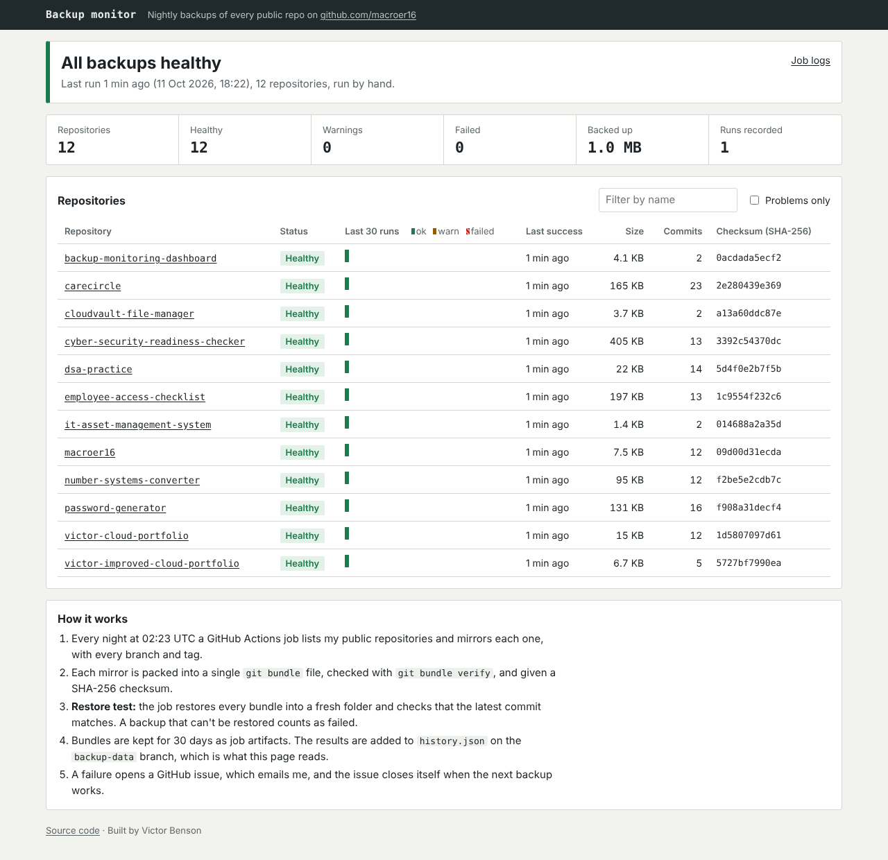

# Backup monitor

[](https://github.com/macroer16/backup-monitoring-dashboard/actions/workflows/test.yml)
[](https://github.com/macroer16/backup-monitoring-dashboard/actions/workflows/backup.yml)

Nightly, restore-tested backups of every public repository on my GitHub, with a live dashboard and email alerts when something fails.

**Live dashboard:** https://macroer16.github.io/backup-monitoring-dashboard/



## Why I built it

Managed IT teams spend a lot of time watching backup jobs, and the classic mistake is a backup that "succeeds" every night but can't actually be restored. I wanted to build the real thing on a small scale: back up something I genuinely care about (my own code), prove every backup can be restored, and get told when it can't.

This started as a front-end mock-up with made-up clients. It now monitors real backups.

## What it does

- **Backs up every public repo automatically.** A GitHub Actions job runs at 02:23 UTC every night. It finds my repositories through the GitHub API, so new repos are included without any changes.
- **Copies everything.** Each repo is mirrored with every branch and tag, then packed into a single `git bundle` file.
- **Verifies each backup** with `git bundle verify` and records a SHA-256 checksum.
- **Restore-tests every backup.** Each bundle is restored into an empty folder, and the latest commit has to match the original. If it can't be restored, it counts as failed.
- **Spots suspicious changes.** If a backup shrinks by more than half, it may mean something was deleted or force-pushed. If it more than doubles, a large file may have been committed by mistake. Either one is flagged as a warning, ignoring changes under 1 MB.
- **Alerts me.** A failed backup opens a GitHub issue, which emails me. Repeat failures comment on the same issue instead of opening new ones, and the issue closes itself when the next backup works. The job is also marked as failed, which sends GitHub's own failure email.
- **Catches a broken job.** If no backup has run for 36 hours, the dashboard goes red, even though no individual backup "failed".
- **Keeps the files.** The bundles are stored for 30 days as workflow artifacts.

## How it fits together

```
GitHub Actions (nightly)                         GitHub Pages
┌───────────────────────────────┐                ┌───────────────────────────┐
│ list repos (GitHub API)       │                │ index.html + src/app.js   │
│ for each repo:                │                │ fetches history.json      │
│   git clone --mirror          │   history.json │ summarise() → status,     │
│   git bundle create + verify  │ ─────────────▶ │ alerts, 30-run timeline   │
│   restore test, SHA-256       │  backup-data   └───────────────────────────┘
│ classify → success/warn/fail  │     branch
│ upload bundles (artifacts)    │
│ open/close alert issues       │ ──▶ GitHub issue ──▶ email
└───────────────────────────────┘
```

The results are kept on a separate `backup-data` branch, so the nightly commits never clutter `main`. The dashboard reads that file straight from GitHub.

## Project layout

| Path | What it is |
|---|---|
| `backup/run-backup.mjs` | The backup job: mirror, bundle, verify, restore-test, record |
| `backup/lib.mjs` | Pure logic: classifying results, planning alerts, trimming history |
| `backup/alert.mjs` | Opens, comments on and closes GitHub issues |
| `src/summary.js` | Turns the history into what the dashboard shows (pure, tested) |
| `src/app.js`, `index.html`, `style.css` | The dashboard |
| `.github/workflows/backup.yml` | The nightly job |
| `tests/` | 23 tests for the logic |

## Run it yourself

Node 22 and git are needed, but there are no npm packages to install.

```bash
npm test                                    # run the tests
REPOS=dsa-practice,carecircle npm run backup  # back up some repos into ./backups
python3 -m http.server                      # then open http://localhost:8000/?data=data/history.json
```

To run a backup on GitHub straight away, go to **Actions → Nightly backup → Run workflow**.

## Limitations (honest ones)

- Only public repositories are backed up. Backing up private ones would need a personal access token stored as a secret.
- The backups are stored on GitHub, the same place as the originals. A real backup should be kept somewhere else (the 3-2-1 rule). The next step is copying the bundles to Amazon S3 with a lifecycle rule moving them to Glacier.
- Issues, pull request discussions and wiki pages aren't included, only the git data.
- GitHub can pause scheduled workflows in repos with no activity for 60 days. The 36-hour staleness alert is there to catch exactly that.

## What I learned

TODO: in my own words.

## Next steps

- Copy the bundles to S3 (versioned bucket, lifecycle to Glacier, least-privilege IAM role via GitHub OIDC, so there are no stored keys)
- A weekly summary email
- Back up private repos with a fine-grained, read-only token
